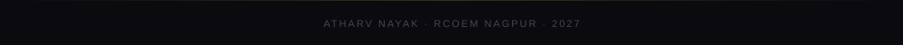

 

B.Tech Electronics and Computer Science at **RCOEM Nagpur** — CGPA 9.1, graduating 2027.
Building full-stack applications end-to-end: schema design, auth, APIs, deployment.
Currently deepening backend fundamentals, DSA, and SQL.

 

| | |
|:--|:--|
| **Languages** |  |
| **Frontend** |  |
| **Backend** |  |
| **Data & Infra** |  |
| **Tools** |  |

`REST` · `JWT` · `OAuth 2.0` · `Socket.IO` · `Database Design` · `API Integration`

 

 

[LinkedIn](https://www.linkedin.com/in/atharv-nayak/) · [atharvnayak10@email.com](mailto:atharvnayak10@email.com)

 

