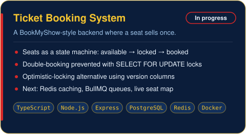
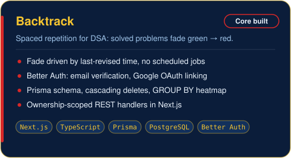
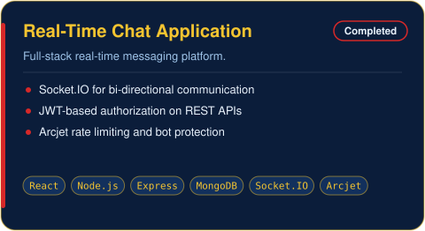
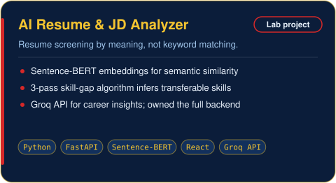

B.Tech student in Electronics and Computer Science at **RCOEM Nagpur** (CGPA 9.1, graduating 2027).
I like backends where correctness matters: concurrent writes, caching, queues, auth. I build the React and Next.js interfaces on top. Open to SDE and backend roles.

<table>
<tr>
<td width="50%" valign="top">
<!-- Once the repo is public, wrap the image:  -->

</td>
<td width="50%" valign="top">
<!-- Once the repo is public, wrap the image:  -->

</td>
</tr>
<tr>
<td width="50%" valign="top">

</td>
<td width="50%" valign="top">

</td>
</tr>
</table>

| | |
|---|---|
| **Languages** |  |
| **Frontend** |  |
| **Backend** |  |
| **Data & Infra** |  |
| **Tools** |  |

**Concepts:** REST architecture · authentication and authorization (JWT, OAuth 2.0) · database design · concurrency control · API integration

Best way to reach me is [LinkedIn](https://www.linkedin.com/in/atharv-nayak/) or [email](mailto:atharvnayak10@email.com).

